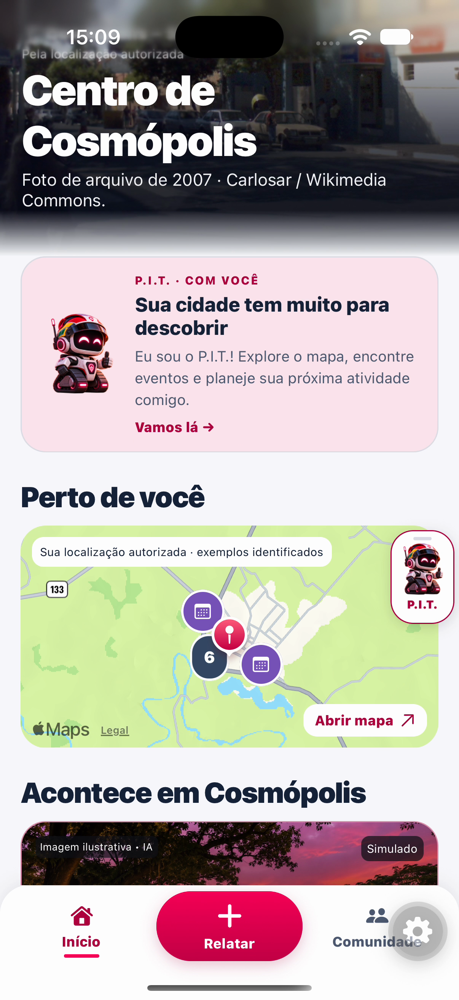
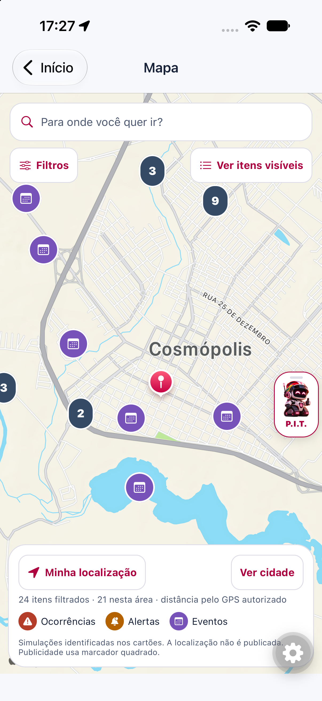
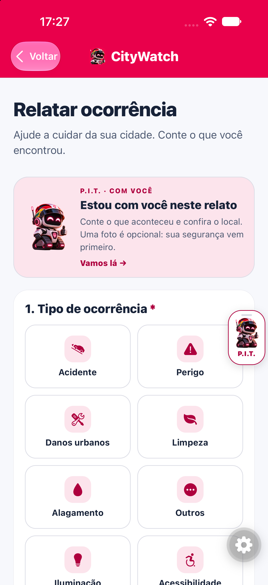
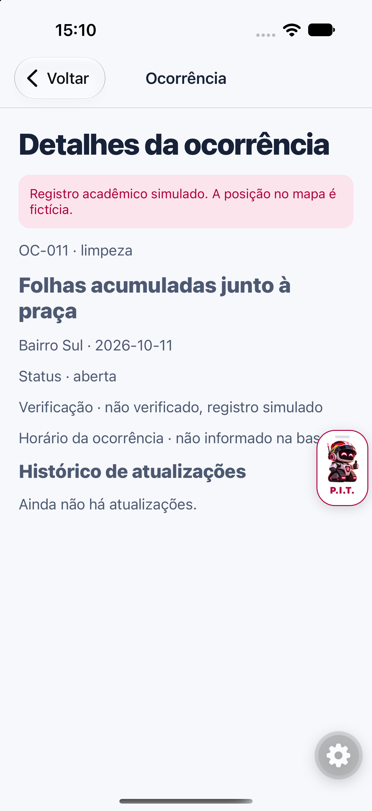
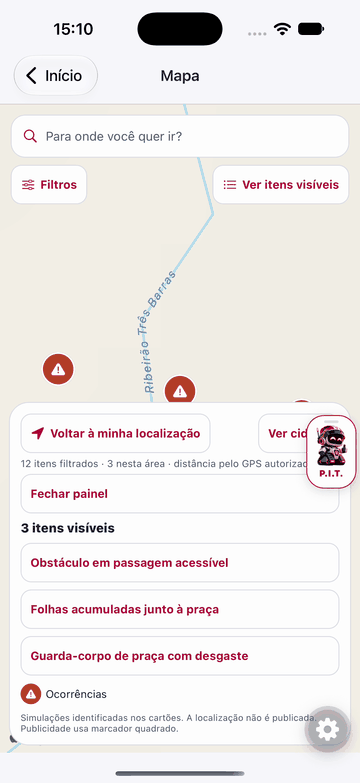

<p align="center"></p>

# CityWatch

**Sua cidade, nossa comunidade.**

CityWatch ajuda moradores a registrar problemas urbanos, consultar ocorrências em um mapa e acompanhar demandas locais. Uma passagem inacessível ou um poste apagado pode virar um relato com descrição e local. A fotografia é opcional.

O projeto foi desenvolvido para a **Global Solution FIAP**. O núcleo Python funciona no terminal e organiza ocorrências fictícias com estruturas de dados e indicadores. O aplicativo React Native/Expo amplia a experiência com mapa, agenda e participação comunitária.

[Capturas](#telas-do-aplicativo) · [Demonstrações](#demonstrações) · [Diagramas](#fluxo-e-arquitetura) · [Execução](#executar-a-versão-acadêmica) · [Validação](#testes-e-evidências) · [Entrega](#links-e-entrega)

## Telas do aplicativo

Capturas reais do iPhone simulado. Os relatos acadêmicos e o catálogo de eventos são demonstrativos.

<table>
<tr>
<td align="center"><a href="docs/evidencias/screenshots/inicio.png"></a><br><strong>Início</strong></td>
<td align="center"><a href="docs/evidencias/screenshots/mapa.png"></a><br><strong>Mapa</strong></td>
<td align="center"><a href="docs/evidencias/screenshots/cadastro.png"></a><br><strong>Cadastro</strong></td>
</tr>
<tr>
<td align="center"><a href="docs/evidencias/screenshots/detalhe-ocorrencia.png"></a><br><strong>Ocorrência</strong></td>
<td align="center"><a href="docs/evidencias/screenshots/agenda.png"></a><br><strong>Agenda</strong></td>
<td align="center"><a href="docs/evidencias/screenshots/pit.png"></a><br><strong>P.I.T.</strong></td>
</tr>
</table>

## Funcionalidades

- **Núcleo Python:** cadastro, busca por ID, filtros, triagem FIFO, status, histórico e indicadores, sem dependências externas.
- **Mapa:** busca, marcadores agrupados, filtros e detalhes. Com permissão de localização em primeiro plano, o município do conteúdo pode acompanhar o GPS.
- **Relatos:** formulário com localização revisável e mídia opcional. A publicação cidadã usa a API FastAPI quando disponível.
- **Comunidade e Agenda:** calendário, detalhes e favoritos de eventos demonstrativos.
- **P.I.T. e perfil:** introdução animada da interface, mascote contextual, sessões com temporizador e interações por atividade. Passos dependem do sensor e da permissão.

O estado técnico do pacote é `0.1.0`. V1 e V2 identificam marcos documentados do protótipo. V3.1 identifica a edição local do vídeo. [Histórico de versões](docs/versoes.md).

## Demonstrações

<table>
<tr>
<td align="center"><br>Mapa e ocorrência</td>
<td align="center"><br>Agenda e evento</td>
<td align="center"><br>Atividade com P.I.T.</td>
</tr>
</table>

[Origem e reprodução das capturas](docs/evidencias/CAPTURA.md) · [Relatório da demonstração V3.1](docs/relatorio-demonstracao-v3-1.md)

## Fluxo e arquitetura

- [Fluxograma de ocorrências](docs/diagramas/fluxograma-ocorrencias.md) — da validação aos indicadores, incluindo fila e histórico.
- [Arquitetura do CityWatch](docs/diagramas/arquitetura.md) — relação entre menu, app, API e armazenamento.

Python implementa as regras. O menu usa CSV e memória ou JSON local. FastAPI e SQLite atendem à extensão mobile. Supabase é opcional para conta e relatos privados. O app usa React Native, Expo Router, TypeScript e APIs do dispositivo.


## Executar a versão acadêmica

É necessário **Python 3.11 ou superior**. Não precisa instalar pacotes, Node, Expo, FastAPI, Supabase ou banco de dados.

```sh
python src/sistema.py
```

Em sistemas nos quais o comando se chama `python3`, use:

```sh
python3 src/sistema.py
```

A execução carrega os CSVs de `data/` e mantém as alterações em memória durante a sessão. Ao sair, a carga original permanece intacta. Para persistir as operações em um arquivo JSON local opcional:

```sh
python3 src/sistema.py --estado data/estado-local.json
```

Não compartilhe arquivos de estado com dados pessoais. O modo JSON é voltado a uma sessão local por vez, sem garantia de gravações simultâneas entre processos. O caminho dos dados pode ser escolhido com `--dados PASTA`.

O menu oferece Cadastro, Listagem, Busca, Filtros, Atualização, Histórico, Fila, Indicadores, Hierarquia e Avisos. **As regras de negócio são as mesmas do backend**, com persistência acadêmica injetada; não há uma segunda versão das regras a manter.

## Executar o aplicativo e a API

Use Node.js 24 e Xcode com simulador iOS para a build nativa. Na raiz do projeto, prepare a API opcional:

```sh
python3 -m venv .venv
.venv/bin/python -m pip install -r backend/requirements-dev.txt
.venv/bin/python -m uvicorn backend.api:app --host 127.0.0.1 --port 8000
```

Em outro terminal, prepare o app:

```sh
npm ci
npx expo start --dev-client --localhost
```

Com Metro em execução, compile e abra no simulador com `npm run ios:native -- --no-bundler`. Consulte [configuração mobile](docs/aplicativo.md) para o iPhone físico, permissões, conexão e Supabase opcional.

## Guia acadêmico

O cenário acadêmico usa bairros fictícios Norte, Sul, Leste e Oeste, com praças e espaços coletivos genéricos. O público inclui moradores e pessoas que precisam de espaços acessíveis e conservados. O CityWatch organiza demandas de iluminação, acessibilidade, limpeza e conservação. O acompanhamento demonstra mudanças de status no sistema.

[Checklist FIAP com evidências](docs/matriz_conformidade.md) · [Transcrição real do menu](docs/evidencias/menu-demonstracao.txt)

<details>
<summary>Dados simulados, estruturas e regras</summary>

## Dados, campos obrigatórios e status

`data/ocorrencias.csv` possui 13 linhas: **12 ocorrências válidas e uma inválida deliberada (`OC-013`, descrição vazia)**. `data/historico.csv` contém **10 atualizações**. São cópias exatas dos CSVs acadêmicos originais em `backend/dados/`, conferidas por teste.

| Arquivo | Colunas, nesta ordem |
| --- | --- |
| `ocorrencias.csv` | `id,categoria,descricao,bairro,data,status` |
| `historico.csv` | `ocorrencia_id,status_anterior,status_novo,data,observacao` |

Formato UTF-8 com cabeçalho, separador vírgula e datas `AAAA-MM-DD`. Código único, categoria, descrição e bairro/local genérico são obrigatórios no cadastro. A data pode ser omitida para usar o dia atual; os dados da demonstração usam datas fictícias explícitas. O ID é normalizado para maiúsculas e aceita até 32 letras, números, hífen ou sublinhado. Categorias/status aceitam variações de caixa e formas sem acento.

| Status | Significado na simulação |
| --- | --- |
| aberta | Registrada e ainda aguardando exame; entra na fila FIFO |
| em análise | Examinada ou em acompanhamento simulado; sai da fila de não examinadas |
| concluída | Encerrada na simulação; não afirma que um órgão público executou reparos |

## Estruturas de dados e justificativas

| Estrutura | Aplicação e motivo |
| --- | --- |
| Lista | Guarda e percorre as ocorrências, permitindo listar, cadastrar e filtrar |
| Fila FIFO (`deque`) | Demandas não examinadas seguem ordem de registro; `popleft()` examina a mais antiga; reabertura entra no fim |
| Pilha LIFO (`list`) | Atualizações entram com `append()`; `pop()` em uma cópia apresenta a última atualização primeiro, preservando o histórico original |
| Dicionário por ID | Busca direta e identificação de duplicatas, evitando depender de percorrer a lista a cada consulta |
| Hierarquia bairro → categoria → ocorrências | Agrupa problemas da mesma localidade e facilita observar necessidades por bairro |
| Matriz 4 × 3 (lista de listas) | Cruza quatro categorias com três status; somas das linhas e colunas produzem os indicadores |

As implementações estão em [estruturas.py](backend/estruturas.py), [ocorrencias.py](backend/ocorrencias.py) e [indicadores.py](backend/indicadores.py). A persistência em arquivo é apenas o suporte de leitura/gravação; as estruturas acima executam as operações do sistema.

## Regras lógicas, validação e tratamento de erros

- `if`, `elif` e `else` em `registrar_status`: rejeitam data anterior, rejeitam repetição de status ou registram a mudança.
- `not valor or not valor.strip()` rejeita tanto campos ausentes quanto textos só com espaços. A mensagem informa o campo obrigatório.
- `if not estruturas.fila` encerra a triagem quando não há demandas; evita remover de uma fila vazia.
- O filtro combina categoria **AND** status; cada campo é opcional e usa **OR** para permitir a ausência do filtro.
- IDs duplicados são rejeitados, inclusive com variação de caixa. Status desconhecidos e datas inválidas não são gravados.
- CSV inconsistente é isolado em avisos, sem derrubar os registros válidos. Buscar `OC-013` resulta em não encontrado; a opção 10 explica a rejeição.
- A alteração é preparada em uma cópia. Uma validação rejeitada não deixa gravação parcial; o JSON é substituído somente após a escrita completa.

Expressão booleana usada na consulta:

```python
(categoria is None or item.categoria == categoria) and (
    status is None or item.status == status
)
```

Cada grupo é verdadeiro quando não foi informado filtro ou quando o valor corresponde ao registro. O `and` exige os dois grupos verdadeiros. Com `categoria="limpeza"` e `status="em análise"`, a carga original retorna `OC-007`.

</details>

<details>
<summary>Entradas, saídas, fórmulas e interpretação dos indicadores</summary>

## Exemplo completo de uso

Em uma sessão nova, escolha **1 Cadastrar** e informe:

```text
ID: DEMO-014
Categoria: iluminação
Descrição: Poste apagado próximo à praça fictícia
Bairro: Bairro Norte
Data: 2026-10-20
Saída: Ocorrência cadastrada.
DEMO-014 | iluminação | Bairro Norte | 2026-10-20 | aberta | Poste apagado próximo à praça fictícia
```

Na opção **3 Buscar**, digite `DEMO-014`. Em **4 Filtrar**, use `iluminação` e `aberta`: o registro aparecerá junto das demandas da mesma categoria/situação. Em **5 Atualizar**, informe:

```text
ID: DEMO-014
Novo status: em análise
Data da alteração: 2026-10-21
Observação: Exame comunitário simulado
Saída: Status atualizado.
```

A opção **6 Histórico**, filtrada por `DEMO-014`, apresenta `aberta → em análise`. A fila já não inclui esse ID. Após esse cadastro, o total será 13 válidas; não confundir com a base original de 12. A opção **0** encerra o sistema.

Exemplos de erro: cadastrar o mesmo ID novamente informa duplicata; buscar `INEXISTENTE` informa não encontrado; atualizar para `resolvida` informa status desconhecido; descrição vazia informa campo obrigatório ausente. Consulte [o roteiro reproduzível](docs/roteiro_video.md).

## Indicadores: origem, fórmulas e interpretação

Resultados da **carga inicial**, antes de cadastrar itens na demonstração:

| Indicador | Regra / fórmula | Resultado |
| --- | --- | --- |
| Total válido | `len(lista)` após validação | 12 |
| Quantidade por categoria | Soma da linha da matriz | 3 por categoria |
| Proporção por categoria | quantidade ÷ total × 100 | 25% cada |
| Quantidade por status | Soma da coluna da matriz | 5 abertas, 4 em análise, 3 concluídas |
| Proporção por status | quantidade ÷ total × 100 | 41,67%, 33,33%, 25% |
| Pendências | abertas + em análise | 9 (75%) |
| Tempo médio simulado de conclusão | soma das durações ÷ concluídas com histórico válido | (4 + 6 + 6) ÷ 3 = **5,33 dias** |

Origem da média: `OC-001` (4 dias), `OC-004` (6 dias), `OC-006` (6 dias). Concluídas sem histórico válido ficam fora da média. A opção 8 exibe origens, matriz, fórmulas e resultados. A base vazia é tratada sem divisão por zero.

**Interpretação:** 75% da amostra permanece pendente. As categorias têm participação igual, mas limpeza concentra duas demandas abertas e nenhuma concluída. As três conclusões fictícias não permitem generalizar um prazo de atendimento real; os indicadores descrevem apenas a amostra simulada.

</details>


## Organização do projeto

```text
README.md                     produto, versões e guia acadêmico
src/sistema.py                entrada acadêmica exigida
src/app/, src/components/     extensão mobile Expo preservada
backend/                     regras Python compartilhadas, menu e API opcional
data/                        CSVs simulados da entrega
docs/uso_ia.md                assistência de IA e verificação
docs/roteiro_video.md         demonstração planejada
docs/matriz_conformidade.md   checklist com evidências
tests/, backend/tests/       testes automatizados
scripts/preparar_entrega.py   empacotamento e geração do TXT quando houver vídeo
entrega/                     pacote publicável e situação da entrega
```

Adotamos as pastas pertinentes do [modelo oficial FIAP](https://github.com/equipe1ccon/FIAP-PORTFOLIO-1CCON/tree/master), que permite adaptar diretórios à natureza do projeto. `notebooks/` não é necessário para este trabalho. O projeto existente foi preservado; não foi criada uma cópia independente das regras de negócio.

## Testes e evidências

**112 testes aprovados** na revisão de 19/11/2026, sendo 38 Python e 74 TypeScript. Typecheck, lint e demonstração real do núcleo acadêmico passaram.

```sh
.venv/bin/python -m unittest discover -s backend/tests -v
node --experimental-strip-types --test tests/*.test.ts
npm run typecheck
npm run lint
python3 scripts/demonstracao_academica.py
```

[Resultados, comparação com a V1 e limites](docs/validacao_entrega.md) · [Roteiro de apresentação](docs/roteiro_video.md)


## Proposta de negócio

O plano é manter o acesso essencial gratuito para cidadãos e validar receitas com divulgação de parceiros, espaços patrocinados identificados e campanhas ou eventos locais. Parcerias também podem apoiar ações solidárias e feiras de adoção. Não há receita ou parceria contratada comprovada. Publicidade deve permanecer distinta de alertas e não comprar confirmação de relatos ou prioridade no atendimento público.

Veja a [visão do produto e modelo de negócio](docs/visao-do-produto.md), incluindo transparência municipal e rotas em desastres como propostas futuras.

Widgets, avisos distribuídos em tempo real, votação pública, encaminhamento oficial e rotas para desastres são propostas futuras. Ranking, medalhas e recompensas aparecem como demonstrações. Os seis GIFs de ação do mascote aguardam quadros próprios. A interface usa o PNG com transparência e respeita a preferência por movimento reduzido. [Guia de produção e fallback do P.I.T.](assets/mascot/animations/README.md)


## Acessibilidade, inclusão e privacidade

O terminal permite operar sem mapas, conta ou smartphone. O menu usa números, rótulos de status e mensagens textuais, sem depender de cores ou imagens. O formato continua sujeito às características do terminal/leitor de tela usado; não foi certificado com todos os recursos assistivos. As categorias incluem obstáculos de acessibilidade, e a descrição do problema pode ser informada sem fotografia ou GPS.

Somente códigos e localidades genéricas aparecem nos CSVs. O modo acadêmico não lê microfone, fotos ou localização. O app adicional solicita permissões contextualmente; o backend público não expõe coordenadas privadas dos relatos. Nenhum encaminhamento à prefeitura é afirmado sem confirmação.

## Uso de IA, conclusões e limitações

A assistência de IA em planejamento, código, dados, documentação e imagens está declarada em [docs/uso_ia.md](docs/uso_ia.md), com distinção entre testes executados e validação humana ainda necessária. O autor deve compreender e justificar as escolhas apresentadas.

O protótipo mostra como relatos podem ser transformados em registros consultáveis, prioridades de exame e indicadores simples. O desenvolvimento evidencia a aplicação prática de FIFO/LIFO, índices por ID, cruzamento de categorias/status e validações booleanas.

Limites: dados fictícios, ausência de atendimento público real, indicador temporal com três conclusões, JSON local sem uso multiprocesso, funcionalidades mobile extras fora do escopo básico e calendário/eventos demonstrativos claramente identificados.

### Aprendizados do desenvolvimento

Ao implementar a triagem e o histórico, ficou claro que cada estrutura resolve um problema de ordem diferente: a fila atende primeiro a demanda mais antiga, enquanto a pilha traz a atualização mais recente para o topo da consulta. O caso OC-013 mostrou por que a validação precisa acontecer antes do cálculo: rejeitar a descrição vazia mantém o registro inconsistente fora dos totais e preserva a carga válida. Rodar o mesmo serviço Python pelo terminal e pela API mostrou como separar regras de negócio da interface facilita testar o cadastro, a busca e as mudanças de status em ambos os fluxos.

## Equipe e identificação

| Campo | Informação |
| --- | --- |
| Projeto / identificação da equipe | CityWatch — trabalho individual |
| Integrante | Yago Souza Araujo |
| RM | 575200 |
| GitHub | [YagoSDev](https://github.com/YagoSDev) |
| Tutor(a) | Nome não informado; completar se exigido pela turma |
| Participação na competição | **A confirmar pelo autor.** O modelo pede essa decisão, mas o enunciado não detalha a competição |
| Vídeo de apresentação | [CityWatch no YouTube](https://www.youtube.com/watch?v=shDn8X4PDFI) |

A atividade aberta no FIAP ON informa entrega na Fase 4, até **19/11/2026 às 23h59**. Há divergência entre o título “1º Semestre” e o corpo “2026.2”; a identificação da edição/pasta deve ser conferida na turma. Não foi inventada uma matrícula de turma ou edição para preencher essa lacuna.

## Links e entrega

- Repositório do projeto: [YagoSDev/citywatch-fiap](https://github.com/YagoSDev/citywatch-fiap), com o código, a documentação e as evidências da entrega.
- Vídeo de apresentação: [CityWatch no YouTube](https://www.youtube.com/watch?v=shDn8X4PDFI).
- Competição: a confirmar; não foi escolhida automaticamente.

O acesso público ao repositório foi confirmado sem login. O [TXT da entrega](entrega/CityWatch-FIAP.txt) contém as duas URLs exigidas. [Situação da entrega](entrega/PENDENCIAS.md).

A referência de estrutura da FIAP possui atribuição CC BY 4.0; consulte [atribuição do modelo](docs/atribuicao_modelo.md). Nenhuma licença para código ou imagens de terceiros foi presumida.
