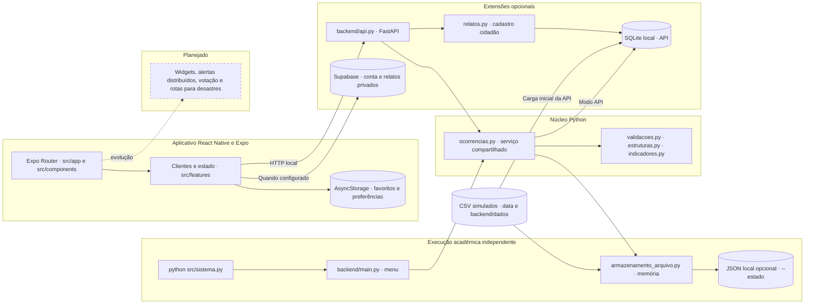

# Arquitetura do CityWatch

O menu injeta o armazenamento em memória ou JSON no mesmo serviço usado pela API com SQLite. Os dois caminhos são independentes na execução. A API também recebe os relatos cidadãos e os incorpora ao núcleo acadêmico. O Supabase atende ao fluxo separado de conta e relatos privados do mobile quando configurado. Mapas, GPS em primeiro plano, ditado, passos e calendário usam recursos do dispositivo conforme a build e as permissões.

Detalhes em [backend](../../backend/README.md), [aplicativo](../aplicativo.md) e [guia de cadastro](../cadastro-ocorrencias.md).
