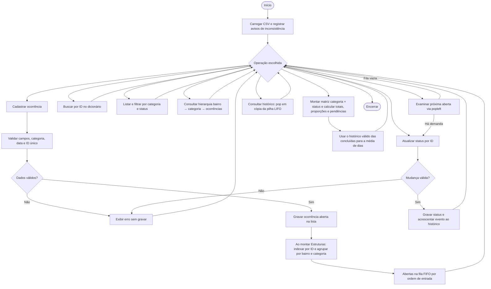

# Fluxo de ocorrências

A triagem altera a ocorrência mais antiga da fila para **em análise**. Nas operações seguintes, a fila é montada com as ocorrências abertas. Uma reabertura recebe uma nova posição no fim da fila. Os status representam acompanhamento simulado. A confirmação do sistema comprova o registro no CityWatch.

Fontes: [menu](../../backend/main.py), [serviço](../../backend/ocorrencias.py), [estruturas](../../backend/estruturas.py) e [indicadores](../../backend/indicadores.py).
