# CityWatch V2 — relatório de funcionamento e evidências

**Autor:** Yago Souza Araujo · **RM:** 575200 · **Data:** 19/11/2026.  
**Contexto:** Global Solution FIAP; núcleo funcional Python e interface React Native/Expo integrada por FastAPI.

As imagens e GIFs abaixo registram execução real. Os dados de ocorrências/eventos são simulados e as imagens de eventos são ilustrativas. O município de Cosmópolis foi obtido a partir de uma **coordenada pública de teste configurada no simulador**, não de rastreamento de um morador. Quadros explicativos do pacote de edição estão identificados separadamente.

## 1. Abertura e Home

O aplicativo apresenta a identidade CityWatch, o mascote P.I.T., a cidade contextual, o mapa e os acessos à Agenda e Comunidade. A fotografia histórica de Cosmópolis informa origem e ano; não é uma imagem atual do local.

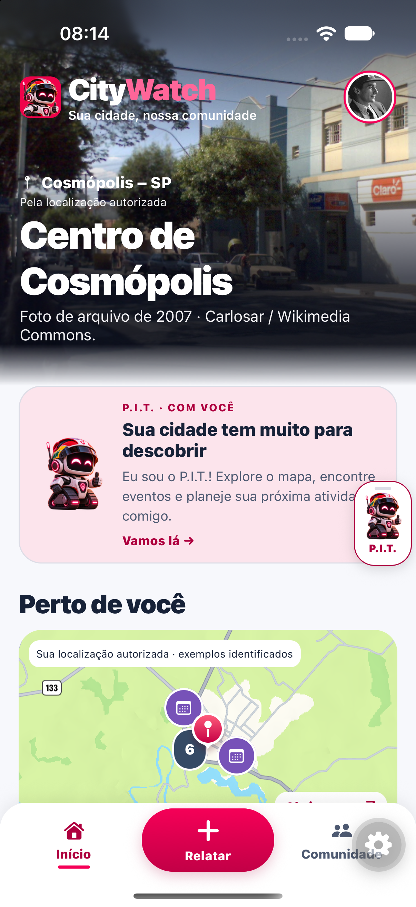

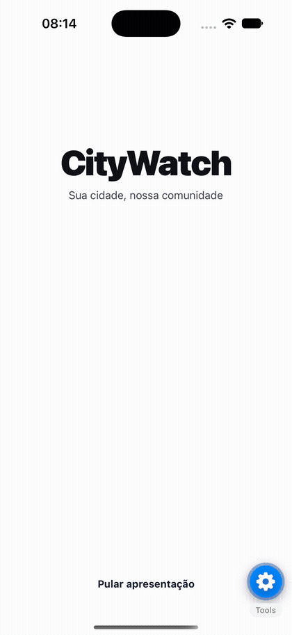

## 2. Mapa e filtros

A experiência expandida permite selecionar categorias e tipos de conteúdo. Na gravação, selecionar Cultura reduziu os itens filtrados de **24 para 2**. A lista de itens visíveis abriu o resumo do Festival Cultural, mantendo o rótulo de simulação e a informação de posição fictícia.

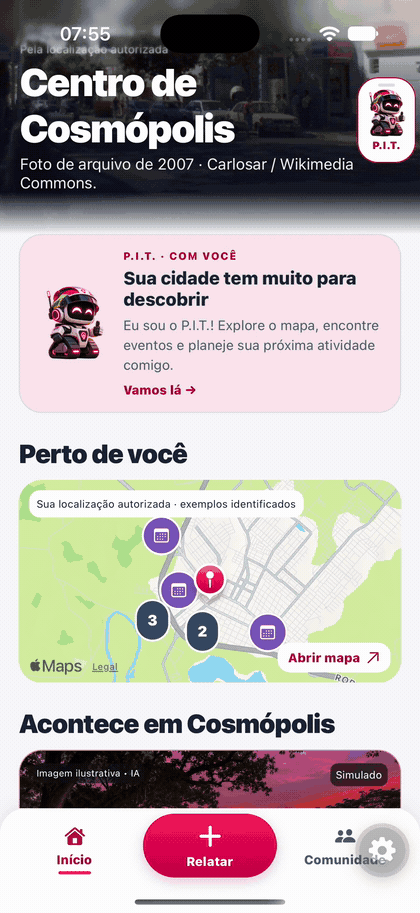

A confirmação de filtragem não transforma eventos simulados em anúncios oficiais. A localização usada na captura é de teste.

## 3. Comunidade, favorito e Agenda

Foi aberto o detalhe do Festival Cultural, marcado como favorito e consultado na Agenda com o filtro **Somente salvos**. A data 28/11/2026 apresentou o mesmo evento como favorito. O favorito usado na demonstração foi desfeito ao terminar.

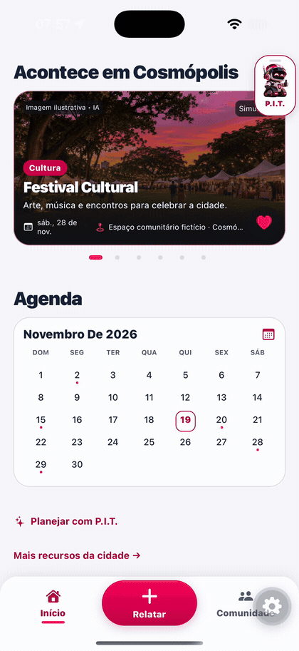

O teste verificou a Agenda interna do CityWatch. Não foi salvo um compromisso no calendário pessoal do macOS/iPhone e nenhuma inscrição em evento real foi realizada.

## 4. Sessão do P.I.T.

Na atividade Trabalhar, o app exibiu tempo restante e tempo decorrido. O botão de café alterou o contador de **0 para 1** e mudou a mensagem do mascote. O registro foi desfeito e a sessão encerrada após a captura. Esses contadores são locais e não geram pontos ou prêmios.

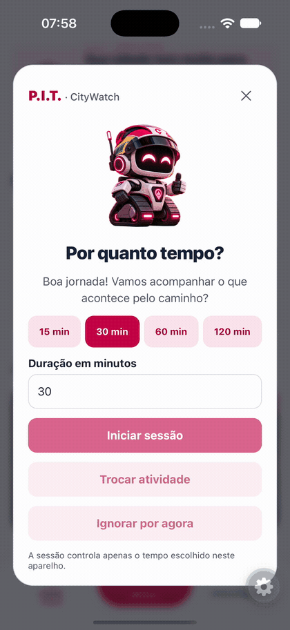

Não há medição real de passos nesta gravação: o simulador não equivale ao sensor do iPhone. Os seis GIFs de estados do personagem continuam pendentes; o GIF acima é uma captura da interface com PNG do mascote e controles em funcionamento.

## 5. Formulário cidadão e API Python

A gravação percorreu o formulário, selecionou Iluminação e demonstrou a validação da descrição obrigatória. **Não foi publicada uma ocorrência por esse formulário nesta captura.** O cadastro e as atualizações completos foram demonstrados no menu acadêmico abaixo, em memória.

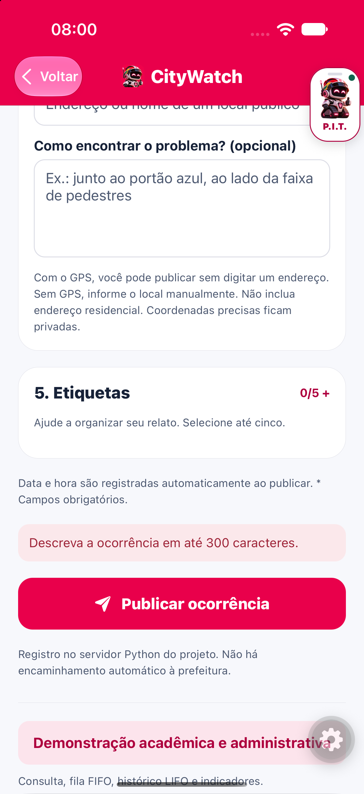

Na área acadêmica do app, os filtros limpeza/em análise retornaram OC-007. A aba Indicadores recebeu da API Python o total inicial de 12 registros, nove pendências e média de 5,33 dias.

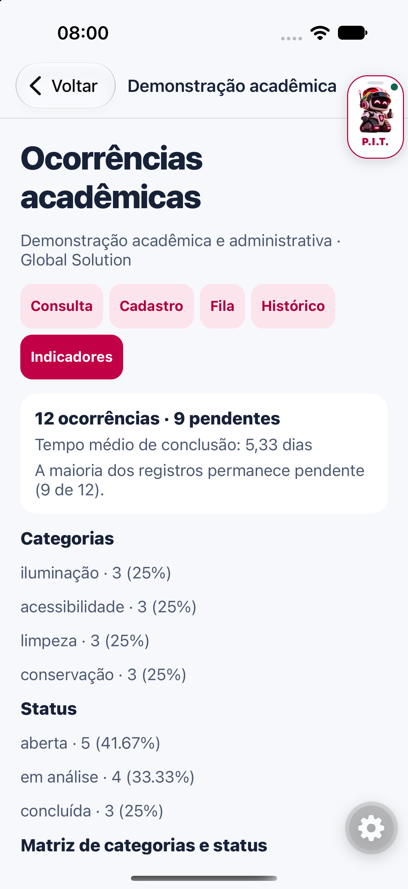

Esses testes não verificaram novamente ditado, câmera, microfone ou GPS físico. Não se afirma envio de denúncia à prefeitura.

## 6. Dados, cadastro, consultas e atualização

O menu real foi executado com `src/sistema.py`, sem banco, API, conta ou rede. Um script de apoio automatizou as respostas a `input()` e reutilizou a entrada original: **as regras e os resultados não foram substituídos por textos de demonstração**. As alterações ficaram em memória; CSVs e banco do aplicativo foram preservados.

- CSV de ocorrências: 13 linhas, sendo 12 válidas e OC-013 inconsistente por descrição vazia.
- Categorias: iluminação, acessibilidade, limpeza e conservação.
- Status: aberta, em análise e concluída.
- Histórico: dez eventos iniciais.
- Listagem, busca OC-007 e filtro combinado limpeza/em análise executados.
- DEMO-014 cadastrada, buscada e atualizada para em análise e depois concluída.
- Histórico apresentou a conclusão de 22/10/2026 antes da análise de 21/10/2026.

## 7. Validações e inconsistência

A sessão de validação demonstrou rejeição de ID duplicado, descrição vazia e status `resolvida`. Uma sessão separada mostrou o aviso de importação de OC-013. A saída é do menu real; os erros previstos são tratados e a execução continua.

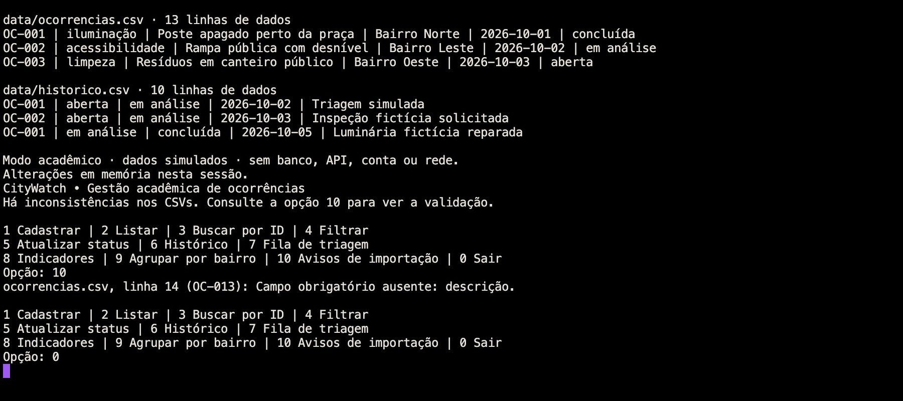

## 8. Estruturas de dados e condições

| Estrutura | Uso demonstrado |
| --- | --- |
| Lista | Guarda, lista e filtra ocorrências |
| Dicionário por ID | Consulta direta e detecção de duplicidade |
| Fila FIFO | Primeira demanda aberta examinada; lista seguinte sem a antiga cabeça |
| Pilha LIFO | Atualização mais recente aparece primeiro; leitura em cópia preserva o histórico |
| Hierarquia bairro → categoria → ocorrências | Agrupamento exibido na opção 9 |
| Matriz 4 × 3 | Cruzamento de categorias/status que alimenta os indicadores |

Os prints de código foram exportados pelo **CodeSnap 1.3.4**, instalado no VS Code. São imagens do código existente, distintas das capturas de execução.

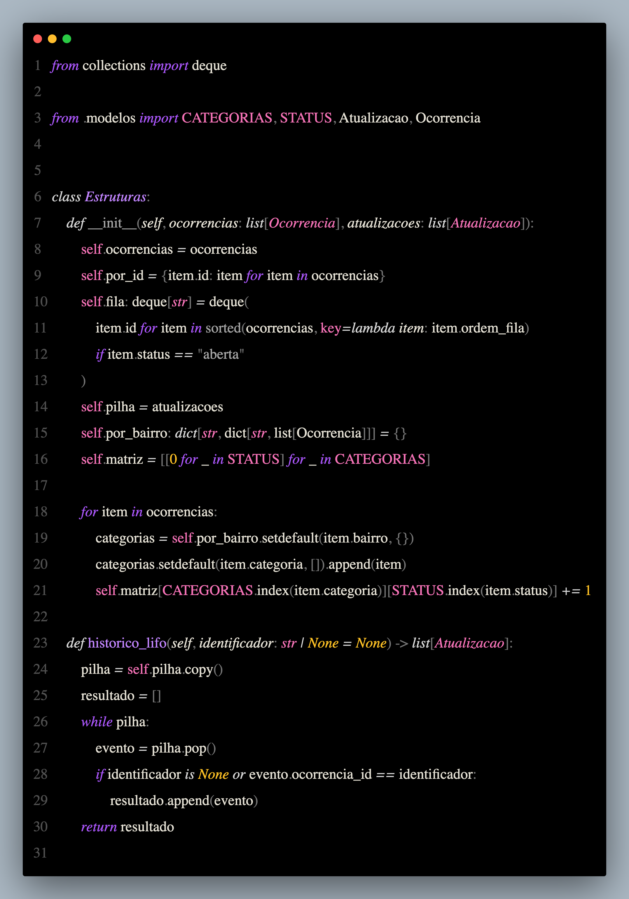

A expressão `(categoria is None or item.categoria == categoria) and (status is None or item.status == status)` permite omitir cada filtro e exige que os critérios informados sejam atendidos simultaneamente. `not valor or not valor.strip()` rejeita campo ausente ou só com espaços; `if not estruturas.fila` trata a fila vazia. As três condições mostram uso funcional de AND, OR e NOT.

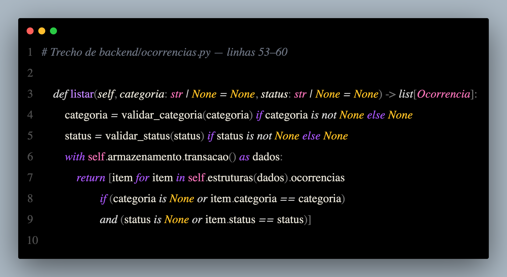

A atualização usa IF para rejeitar data anterior, ELIF para rejeitar status repetido e ELSE para preparar a alteração válida.

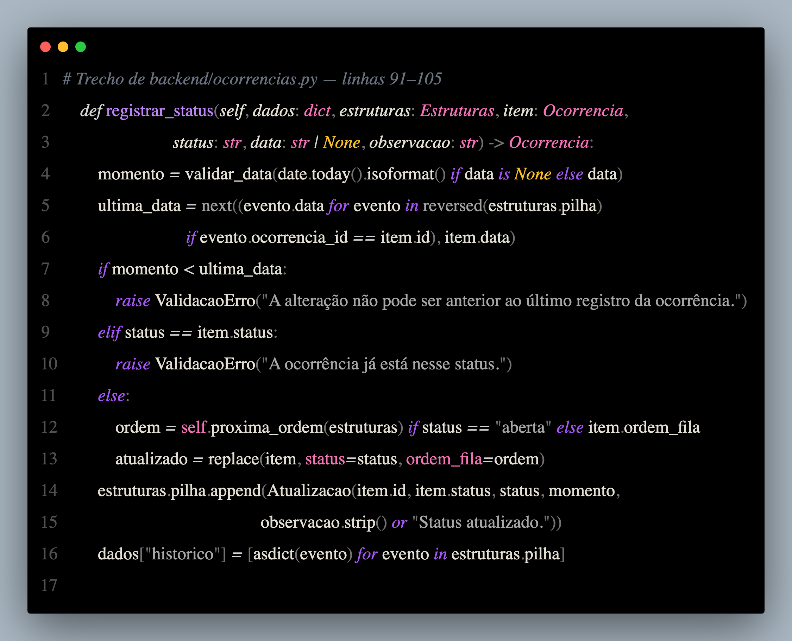

## 9. Indicadores, origem e interpretação

O relatório foi capturado em **uma sessão nova da base inicial**, sem misturar seus números com a sessão que cadastrou DEMO-014.

| Indicador | Origem e cálculo | Resultado |
| --- | --- | --- |
| Total válido | Contagem após validação | 12 |
| Categorias | Três registros por categoria; `3/12 × 100` | 25% cada |
| Status | 5 abertas, 4 em análise, 3 concluídas; `quantidade/12 × 100` | 41,67%, 33,33%, 25% |
| Pendências | `5 + 4`; `9/12 × 100` | 9, ou 75% |
| Média simulada de conclusão | OC-001: 4 dias; OC-004: 6; OC-006: 6; `(4+6+6)/3` | 5,33 dias |

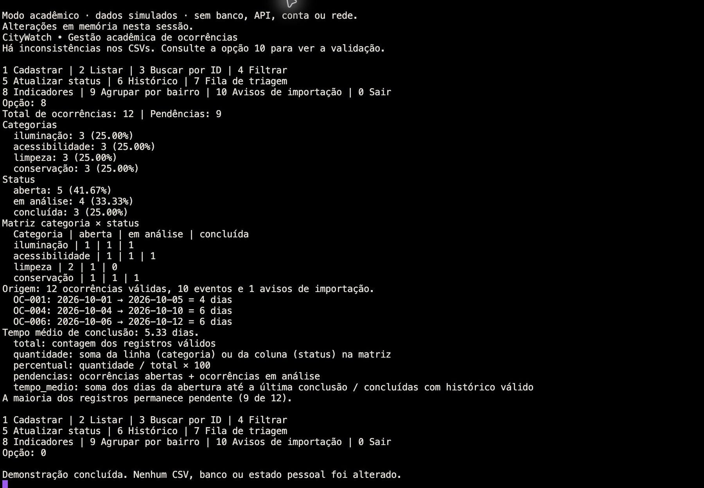

A maior parte da amostra permanece pendente. Limpeza tem duas demandas abertas e nenhuma concluída. A média usa apenas três conclusões fictícias e não estima o atendimento de uma cidade real.

## 10. Testes executados nesta preparação

| Verificação | Resultado real |
| --- | --- |
| `.venv/bin/python -m unittest discover -s backend/tests` | 38 aprovados |
| `node --experimental-strip-types --test --test-reporter=spec tests/*.test.ts` | 74 aprovados, zero falhas |
| `npm run typecheck` | Código de saída 0 |
| `npm run lint` | Código de saída 0 |

**Total: 112 testes aprovados.** Os comandos foram executados novamente em 19/11/2026 para a captura. Os logs completos ficam na pasta local `entrega/midia-v2-20261119/logs/`, junto da transcrição do menu. Os testes de TypeScript emitiram avisos do Node sobre tipo de módulo; não houve falha nesses checks.

Os testes verificam regras e comportamento, não certificam todos os dispositivos, permissões, acessibilidade ou serviços externos. O uso de IA está declarado em [uso_ia.md](uso_ia.md).

## 11. Proposta comercial e próximos passos

Os quadros de apoio do pacote de edição distinguem implementação de planejamento. O modelo proposto mantém o acesso essencial gratuito e considera divulgação de parceiros e patrocínios identificados. Não há receita ou contratos comprovados. Widgets, avisos distribuídos, respostas oficiais de prefeituras e rotas em desastres ainda são propostas, sem garantia de segurança de trajetos.

## 12. Arquivos de edição e limites da entrega

Os MP4s, GIFs, prints, originais e índice estão na pasta local **`entrega/midia-v2-20261119/`**. Os vídeos do simulador mostram apenas a tela do app; os trechos de terminal foram recortados para a área útil. Há material por etapa do [roteiro V2](roteiro_video.md), para intercalar com a fala do autor.

O pacote não contém a fala/câmera do autor nem constitui o vídeo final de 3–5 minutos. O repositório permanece privado; nenhuma gravação foi enviada ao YouTube ou à FIAP nesta preparação. Os arquivos brutos não são versionados; este relatório usa somente uma seleção das evidências.
