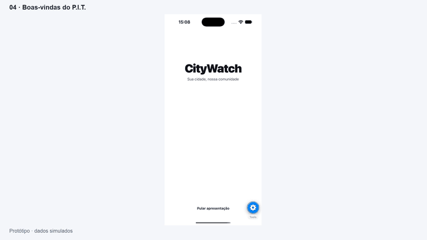
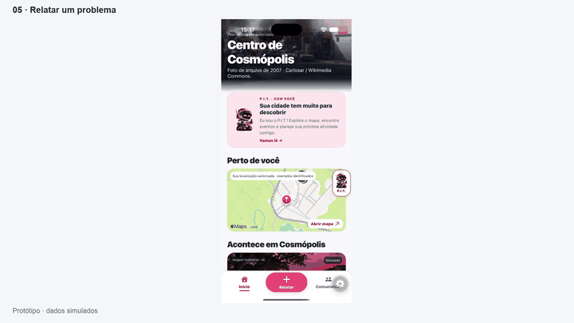
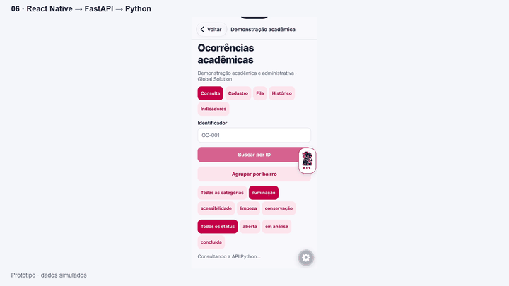
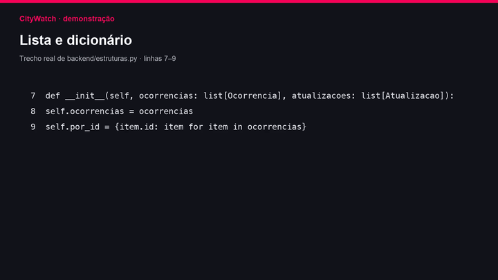
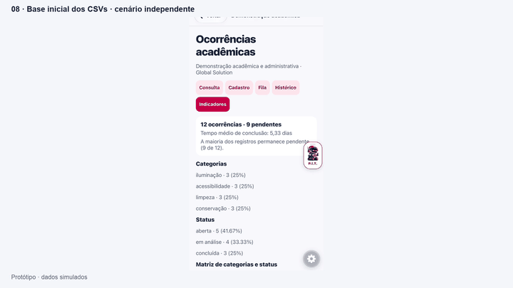
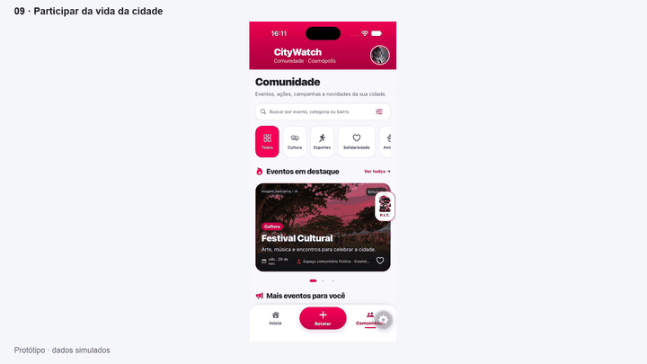
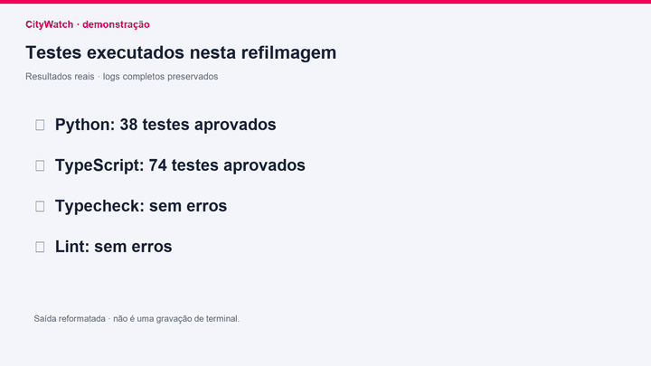

# CityWatch — evidências da refilmagem V3

Esta versão substitui as evidências audiovisuais da V2 para a nova montagem. As telas são do aplicativo em execução; os dados são simulados. As vozes e vídeos pessoais completos ficam apenas no pacote local.

## Etapas demonstradas

### 4. Abertura, mapa e filtros

[Abrir print em resolução original](evidencias/screenshots/detalhe-ocorrencia.png)

### 5. Cadastro e confirmação Python

[Abrir print em resolução original](evidencias/demonstracao-v3/05-confirmacao-python.png)

### 6. Busca, filtros, status e validações

[Abrir print em resolução original](evidencias/demonstracao-v3/06-concluida-historico.png)

### 7. Estruturas de dados e condições

[Abrir print em resolução original](evidencias/demonstracao-v3/07-pilha-duas-atualizacoes.png)

### 8. Indicadores e interpretação

[Abrir print em resolução original](evidencias/demonstracao-v3/08-formulas-e-inconsistencia.png)

### 9. Comunidade, Agenda e P.I.T.

[Abrir print em resolução original](evidencias/demonstracao-v3/09-timer-completo.png)

### 10. Testes, documentação e limites

[Abrir print em resolução original](evidencias/demonstracao-v3/10-testes.png)

## Verificação e origem

Cadastro de teste confirmado por Python, com o mesmo identificador consultado e acompanhado até a conclusão. Fila e histórico são funcionais; condições e estruturas são trechos reais do código. A demonstração dos indicadores retorna à base inicial dos CSVs e identifica esse cenário.

38 testes Python + 74 TypeScript aprovados; typecheck e lint sem erros. Quadros de resultados e erros exibem saídas reais reformatadas para leitura, sem simular uma gravação de terminal. GIFs são resumos silenciosos da montagem.

A base habitual foi restaurada aos 12 registros e 10 eventos anteriores após retirar exclusivamente o teste do vídeo. Nenhuma regra acadêmica foi modificada.

A abertura animada é do aplicativo. Não são usadas cenas externas de IA para substituir o funcionamento demonstrado. O uso de IA na assistência ao desenvolvimento e à edição permanece declarado.

[Plano da refilmagem](video-v3/plano-de-captura.md) · [Roteiro falado](video-v3/narracao-4-a-10.md)
